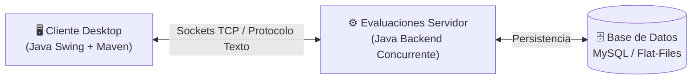

# ☕ Sistema de Evaluación Académica (Cliente Desktop)

[](https://openjdk.org/)
[](https://maven.apache.org/)
[](https://www.mysql.com/)
[]()
[]()

Aplicación de escritorio interactiva en **Java Swing** construida con arquitectura Cliente-Servidor para la administración, ejecución y corrección de evaluaciones estudiantiles, gestión de historiales académicos y emisión de actas de calificaciones. 

Desarrollada para conectarse de manera concurrente con el servidor evaluador central ([evaluacionesServidor](https://github.com/gavafue/evaluacionesServidor)).

---

## 🎯 Características Principales

* 🔐 **Autenticación y Control de Acceso:** Módulo de inicio de sesión (`Login.java`) y registro de usuarios (`Registro.java`) con cifrado y validación de roles (Docente / Estudiante).
* 📊 **Dashboard Integral:** Panel de control modular (`Dashboard.java`) con navegación por pestañas y diseño ergonómico.
* 📝 **Gestión de Evaluaciones:** Creación, edición, activación y supervisión de cuestionarios y pruebas diagnósticas (`GestionEvaluacionesPanel.java`).
* 📈 **Historiales y Rendimiento:** Visualización tabular de resultados, respuestas entregadas por el alumno y análisis comparativo de respuestas correctas (`VerHistorialesPanel.java`, `VerRespuestasEstudiante.java`, `VerRespuestasCorrectas.java`).
* 🎨 **Renderizado Dinámico:** Codificación cromática de aprobaciones y llamadas de atención en tiempo real mediante `RendererColores.java`.
* 💻 **Consola de Monitoreo:** Diagnóstico de sockets y trazas de red cliente-servidor (`Consola.java`).

---

## 🏗️ Arquitectura de la Solución



---

## 📦 Requisitos y Configuración

* **JDK:** OpenJDK 17 o superior.
* **Gestor de dependencias:** Apache Maven 3.8+.
* **Servidor backend:** Instancia activa de [evaluacionesServidor](https://github.com/gavafue/evaluacionesServidor).

### Compilación y Ejecución

```bash
# Clonar el repositorio
git clone https://github.com/gavafue/Taller2-SistemaEvaluacion.git
cd Taller2-SistemaEvaluacion

# Compilar y empaquetar con dependencias
mvn clean package

# Ejecutar el cliente
java -jar target/ClientePrueba-1.0-SNAPSHOT-jar-with-dependencies.jar
```

---

## 👥 Equipo de Desarrollo (Taller 2 - INET)

Proyecto anual desarrollado en equipo para la cátedra **Taller 2** de la carrera de **Profesorado de Informática (INET - CFE)**:

| Colaborador | Perfil GitHub | Aportes Clave |
| :--- | :--- | :--- |
| **Gabriel Vázquez** | [@gavafue](https://github.com/gavafue) | Arquitectura cliente-servidor, módulos de dashboard y conexión de red |
| **Juan Carlos Acuña** | [@jucaacuna](https://github.com/jucaacuna) | Interfaz Swing, paneles de evaluación y gestión de respuestas |
| **Prof. Santiago** | [@profesantiago64](https://github.com/profesantiago64) | Lógica de negocio académica, validaciones y renderizado de calificaciones |
| **Ana Julia Rodríguez** | [@anajuliavr](https://github.com/anajuliavr) | Gestión de usuarios, autenticación y formularios de historiales |
| **Gonzalo Manuel Vázquez Fuentes** | [@gonzalovaz1](https://github.com/gonzalovaz1) | Protocolo de comunicación por sockets y control de calidad |
